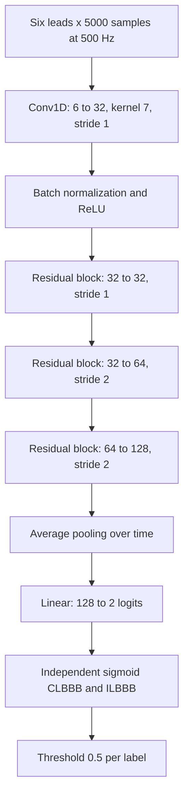

# Lida: non-diagnostic leads, Experiments 5 and 6 (500 Hz)

## Scope and provenance

Work is on `feature/lida-non-diagnostic-leads`, created from Lida's previous
`feature/ptbxl-resnet-training` (`3e5e709`). The initial working tree was clean.
Remote branches were fetched without merging. Prisha's latest Dataset 1 branch
is `origin/feature/dataset1-12lead-clean` at `4d82a77`; the data-processing branch
is `bdbbe2e`. Both contain the same Dataset 1 learning pipeline. Neither has a
Dataset 2 builder. Experiment changes are confined to Lida's branch; other
branches and main are not modified or merged.

The implementation adapts Prisha's `02_build_dataset1.py`,
`05_prepare_waveforms.py`, `08_train_resnet.py`, and `10_evaluate_test.py` into
`non_diagnostic_leads.py` with configurable paths and integrity checks. Her
`07_resnet_model.py` is retained under `learning_pipeline/`; the only functional
change is an optional `in_channels=12` argument. Experiment 5 passes 6. Lida's
existing seed utility and file hashing utility are reused. Existing V6 files
and reports are preserved.

## Previous work: V6-only ResNet

The versioned `reports/ptbxl_resnet_500hz/{experiment,metrics,audit}.json` and
README verify PTB-XL V6 at 500 Hz, 5,000 samples per ECG, isolated high-confidence
CLBBB versus strictly Normal, official patient-separated folds 1–8/9/10, early
stopping after 13 epochs, and the best checkpoint at epoch 8.

Saved test accuracy is **99.6875%** (99.69% rounded), CLBBB precision 92.59%,
recall 100%, and F1 **96.15%**. The confusion matrix is `[[613,2],[0,25]]`:
all 25 CLBBB test recordings were identified and two Normal recordings were
incorrectly positive. These are verified against the existing aggregate saved
results and code, not a new inference run of the original checkpoint.

The requested description of **weighted BCE** is a historical note that is
**not supported by the saved experiment**. The previous model used two mutually
exclusive Normal/CLBBB logits and **weighted cross entropy**, with training-only
weights `[0.51795876,14.42076492]`. Experiments 5/6 instead need two independent
binary outputs and use weighted BCE as in Prisha's pipeline.

The previous audit reports zero cross-split patient IDs, ECG IDs, paths and exact
waveform overlaps. It also explicitly records earlier development exposure to
fold 10. Those historical scores are not pristine independent final validation.

## Experiment 5: Dataset 1

Labels use SCP **code presence**, exactly as in Prisha's implementation (not a
new confidence threshold). Each recording has `[CLBBB, ILBBB]` binary labels;
a recording may have both. Positive recordings may have other diagnoses.
A Normal negative must contain `NORM` and no additional code designated diagnostic
in `scp_statements.csv`. Non-diagnostic rhythm/form statements are permitted by
the team's policy. This differs from the older V6 experiment's stricter policy.

The six channels are extracted in exactly this order:
**II, III, aVR, aVF, V3, V4**. Header names are matched case-insensitively.
Inputs now use the original **500 Hz**, **5,000-sample** (10 second) PTB-XL
recordings from **`records500`**, selected by **`filename_hr`**. Arrays contain
physical mV, float32, shape `(N,6,5000)`. There is no extra filtering, resampling,
upsampling, augmentation, or fitted normalization. The previous six-lead 100 Hz
run is historical and is not used as the source of waveforms, weights or scores
for this retraining.
Raw frequency, dimensions, lead identity, units and finite values are checked
for every selected recording during extraction. An independent reread of all
9,682 original WFDB recordings also matched every exported float32 sample on all
six channels exactly. All raw headers confirmed 500 Hz and 5,000 samples.

The recording IDs, patient IDs, official folds and both label arrays were compared
with the previous exports and are identical; only the waveform resolution changed.

Official PTB-XL folds 1–8 train, 9 validate, 10 test are retained. The loader
rejects patients spanning folds, duplicate recording IDs or paths, invalid folds,
label-array disagreement and invalid waveform shapes. Before evaluating across
datasets, it also rejects test patients appearing in the trained model's
training or validation cohort. Dataset 1 has zero cross-split patient overlap.

| Split | Recordings | Patients | CLBBB positive / negative | ILBBB positive / negative |
|---|---:|---:|---:|---:|
| Train | 7,733 | 7,174 | 428 / 7,305 | 62 / 7,671 |
| Validation | 975 | 916 | 54 / 921 | 7 / 968 |
| Test | 974 | 883 | 54 / 920 | 8 / 966 |

Training follows the team configuration: seed 42, batch size 32, Adam at 0.001,
maximum 30 epochs, patience 7, and BCEWithLogitsLoss. For each output, positive
weight is training negatives divided by training positives. Validation uses
those same fixed weights. The checkpoint with the lowest validation loss is
restored before test inference. The main threshold is 0.5 for each sigmoid
output. No test-driven threshold selection, additional seeds, cross-validation,
or architecture comparison is performed. Additional threshold exploration is
omitted because validation contains only seven ILBBB recordings.

**Completed at 500 Hz:** fresh training on the Mac GPU stopped after 10 epochs.
The restored best checkpoint is epoch **3**, validation weighted BCE
**0.4496812247**. Training-only positive weights remain CLBBB
**17.06775665** and ILBBB **123.72580719**.

Dataset 1 test results at the fixed 0.5 threshold, using native 500 Hz recordings:

| Output | Accuracy | Precision | Recall | F1 | TN | FP | FN | TP |
|---|---:|---:|---:|---:|---:|---:|---:|---:|
| CLBBB | 97.54% | 70.27% | 96.30% | 81.25% | 898 | 22 | 2 | 52 |
| ILBBB | 86.55% | 5.11% | 87.50% | 9.66% | 836 | 130 | 1 | 7 |

Confusion matrices (true rows / predicted columns, negative then positive):
CLBBB `[[898, 22], [2, 52]]`; ILBBB `[[836, 130], [1, 7]]`.

CLBBB missed 2 of 54 positives and produced 22 false positives.
ILBBB found 7 of eight positives but produced 130 false positives;
the precision and F1 above quantify its limitation in this severely imbalanced cohort.
No thresholds or model settings were adjusted after seeing these test results.
Dataset 2 test evaluation remains pending until an approved team export is available.

The previous **100 Hz** results are preserved separately under
`reports/lida_non_diagnostic_leads_100hz_historical/` and are not 500 Hz results.
Old data and weights remain under `data/lida/dataset1/` and
`outputs/lida/experiment5_mps/`; the updated loader rejects their 100 Hz contract.

## Experiment 6: Dataset 2

**Pending, not trained.** No Dataset 2 implementation, selection policy or
validated export was found in the fetched team branches. Dataset 1 is never
substituted for Dataset 2. Dataset 2 counts and model performance are unknown.

The runner accepts an approved Dataset 2 export with the same six-lead waveform
contract and separate `[CLBBB,ILBBB]` labels. The team must supply the labeling
policy, including treatment of ambiguous/missing codes and the definition of
“All Others,” and the official-fold cohort manifests. Then Experiment 6 can use
the same architecture and training procedure and evaluate both test cohorts.
Export metadata checks validate consistency; they do not certify the semantics
of a future external Dataset 2 builder, which must be reviewed against its policy.

Required export files: `contract.json`, and `{train,val,test}.csv`,
`X_{train,val,test}.npy`, `y_{train,val,test}.npy`. CSV columns include `ecg_id`,
`patient_id`, `strat_fold`, `filename_hr`, `CLBBB`, `ILBBB`. Arrays have shapes
`(N,6,5000)` and `(N,2)`. Contract fields are `dataset: dataset2`, `leads` in the
order above, `labels: [CLBBB,ILBBB]`, `fs: 500`, `samples: 5000`,
`normalization: none`, `source_column: filename_hr`,
`waveform_directory: records500`, `units: mV`, and a nonempty `policy` identifying the team policy/source.

## Model architecture

Before changing preprocessing, the existing architecture passed a forward and
backward check from `(2,6,5000)` to `(2,2)`. **No architecture changes are needed
for 5,000 samples.** Convolutions support variable sequence lengths and adaptive
average pooling always yields 128 features for the existing linear head. The
architecture source is unchanged by this 500 Hz update.


A one-dimensional convolution learns short patterns along time across the six
leads. Three residual blocks learn progressively richer patterns. Each block
adds its input through a shortcut, helping gradients pass through the network.
The last two blocks halve the time resolution and increase the feature count.
Average pooling summarizes time. A linear layer gives two scores, one per label;
sigmoid converts each score independently to a probability.



Each residual block contains two kernel-7 convolutions with batch normalization,
ReLU after the first convolution and after adding the shortcut. A kernel-1
projection on the shortcut handles changes in width or time resolution.
Batch normalization learns statistics during training and freezes them for
validation and test. The architecture matches Prisha's 12-lead model apart from
the input channel count; the two-output head already supports the requested task.

## Reproduction and artifacts

Run from the repository root using the existing environment:

```bash
.venv/bin/python non_diagnostic_leads.py prepare \
  --raw-root /Users/lb/Desktop/PTB-XL --output data/lida/dataset1_500hz
OMP_NUM_THREADS=1 MPLCONFIGDIR=/tmp/lida-mpl .venv/bin/python non_diagnostic_leads.py train \
  --dataset1 data/lida/dataset1_500hz --output outputs/lida/experiment5_500hz_mps --device mps
```

The 500 Hz run uses MPS (Mac GPU), requiring a session with GPU access;
`--device cpu` also works but is slower. Training starts from fresh seed-42
initialization and does not load the old 100 Hz checkpoint. All loss settings,
patient folds, labels and architecture remain the same.

Output directories must be new; existing files are never overwritten. Preparation
is already complete locally. The new loader rejects historical 100 Hz
contracts and requires 5,000 samples for both Dataset 1 and Dataset 2. To train Experiment 6 when Dataset 2 is provided:

```bash
OMP_NUM_THREADS=1 .venv/bin/python non_diagnostic_leads.py train \
  --dataset1 data/lida/dataset1_500hz --dataset2 data/lida/dataset2_500hz \
  --train dataset2 --output outputs/lida/experiment6_500hz
```

To evaluate Experiment 5 on both datasets later without retraining:

```bash
OMP_NUM_THREADS=1 .venv/bin/python non_diagnostic_leads.py train \
  --dataset1 data/lida/dataset1_500hz --dataset2 data/lida/dataset2_500hz \
  --checkpoint outputs/lida/experiment5_500hz_mps/best_model.pt \
  --output outputs/lida/experiment5_500hz_both_tests
```

Each training run saves `best_model.pt`, `history.json`, `provenance.json`,
`metrics.json`, and per-test `*_test_predictions.npz`. Checkpoints include lead
and label order, seed, positive weights, epoch, validation loss, architecture
hash and export provenance. Provenance records split counts and SHA-256 hashes
of arrays, manifests and contracts. Evaluation-only mode checks the checkpoint's
training export fingerprints and architecture. Metrics report accuracy,
precision, recall, F1 and a 2x2 confusion matrix per label at 0.5; confusion
matrices use true rows / predicted columns in negative, positive order.

Data, predictions and weights remain in Git-ignored `data/` and `outputs/`.
Small aggregate results are copied into `reports/lida_non_diagnostic_leads/`.

## Limitations

ILBBB has only 62 training, seven validation and eight test recordings. A single
miss changes test recall by 12.5 percentage points. Weighted BCE addresses loss
imbalance but does not add examples or ensure calibrated probabilities. Accuracy
can remain high when a model misses most rare positives; per-label recall, F1 and
confusion matrices must be read alongside it. Recording-level metrics do not
provide independent patient-level confidence intervals.

Dataset 1 is a restricted Normal-versus-LBBB cohort. Performance against other
abnormalities remains unmeasured until Dataset 2 is available. Official patient
separation prevents direct patient overlap but does not eliminate acquisition,
age, device, or other confounding. The historical fold-10 exposure also applies
to the overlapping source cohort here, so this is an internal held-out evaluation,
not external untouched validation. No new exhaustive waveform-duplicate or
transformed-copy audit is claimed. There is no clinical deployment validation. Kernel sizes and strides remain
unchanged in samples, so their time span is shorter at 500 Hz than at 100 Hz;
no architecture tuning was performed for the changed sample rate.


## Final verification

All **61 tests pass**, including forward/backward execution on `(2,6,5000)`,
independent binary outputs, native-rate extraction, header-based lead ordering,
rejection of 100 Hz/wrong-length waveforms, rejection of old export contracts,
label-policy checks, patient leakage, checkpoint reload and evaluation-only mode.
There are 20 existing WFDB/pandas deprecation warnings and no test failures.
`pip check` reports no broken requirements. The architecture source hash is
unchanged from the prior six-lead run. All 9,682 exported waveforms match their
original native 500 Hz records exactly; IDs, folds and labels match the previous
cohort. Export fingerprints match the saved checkpoint, and its selected epoch
has the minimum validation loss. Recomputing metrics from saved predictions
reproduces all reported scores, and saved truths match the official Dataset 1
test labels. Zero patient overlap occurs across train/validation/test.

The fresh 500 Hz checkpoint is
`outputs/lida/experiment5_500hz_mps/best_model.pt`. Full predictions are in the
same ignored directory. Current aggregate results, history, configuration,
provenance and raw verification are in `reports/lida_non_diagnostic_leads/`.
Historical 100 Hz artifacts remain separate. Data and weights are Git-ignored.
No other branches were modified, merged or deleted. Experiment 6 and all
Dataset 2 test evaluations remain pending; the same loader now requires 500 Hz,
5,000 samples and `filename_hr`/`records500` provenance for either dataset.
