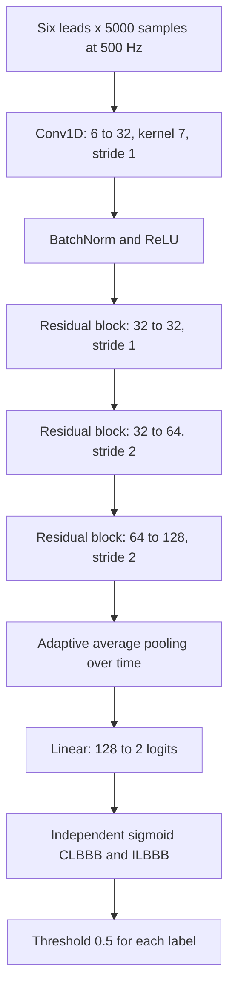

# Six-lead data contracts and architecture

Experiments 5 and 6 use II, III, aVR, aVF, V3, V4 at 500 Hz, with 5,000 samples
per channel. Main methods, class counts, training settings, reproduction commands,
results and limitations are in [the README](../README.md).

## Export contract

The verified exports are `data/dataset1_500hz/` and `data/dataset2_500hz/`.
Both match the designated source builders; see `results/dataset_sources_verification.json`.
Each dataset must supply:

- `contract.json` with its dataset identifier (`dataset1` or `dataset2`),
  `leads: [II, III, aVR, aVF, V3, V4]`, `labels: [CLBBB, ILBBB]`,
  `fs: 500`, `samples: 5000`, `source_column: filename_hr`,
  `waveform_directory: records500`, `units: mV`, `normalization: none`,
  and a nonempty policy description.
- `train.csv`, `val.csv`, `test.csv` containing `ecg_id`, `patient_id`,
  `strat_fold`, `filename_hr`, `CLBBB` and `ILBBB`.
- Corresponding `X_train.npy`, `X_val.npy`, `X_test.npy` float32 arrays shaped
  `(N,6,5000)`, plus binary `y_train.npy`, `y_val.npy`, `y_test.npy` shaped `(N,2)`.

Dataset 1 labels use code presence; LBBB positives may include other diagnoses.
Normal negatives require NORM without another diagnostic code. Official folds
1–8/9/10 define train/validation/test. The loader rejects invalid contracts,
label misalignment, duplicate recordings and patients spanning folds. Across
datasets, test patients cannot occur in the trained model's training or
validation cohorts. Dataset 2 selection is implemented from its pinned source builder and verified
record-for-record; the loader additionally checks export consistency.

## Architecture

`ecg_resnet.ECGResNet` accepts exactly `(N,6,5000)` and returns two logits.
The residual layers, channel widths, convolution strides, pooling and classifier
match the saved Experiment 5 model. There are 243,234 trainable parameters.

## Preserved Experiment 5 checkpoint

The model remains at `outputs/experiment5_500hz/best_model.pt`. Relocation and
neutral policy descriptions required refreshing checkpoint metadata and file
fingerprints. All model tensors, waveform arrays, labels, saved predictions and
numerical metrics were preserved; no retraining was performed. Source/checkpoint
hashes and the model tensor digest are recorded in the aggregate summary.
Only metadata changes account for the new serialized checkpoint checksum.

Experiment 6 and both models' evaluations on both test datasets are complete.
Exact results and configurations are in `results/assignment_results.json`.
Dataset 2 includes all source ECGs; its builder preserves the source assertion
that no recording has both LBBB labels. This holds in the current corpus.
Dataset 1 keeps the diagnostic-only Normal rule, including form/rhythm annotations.
